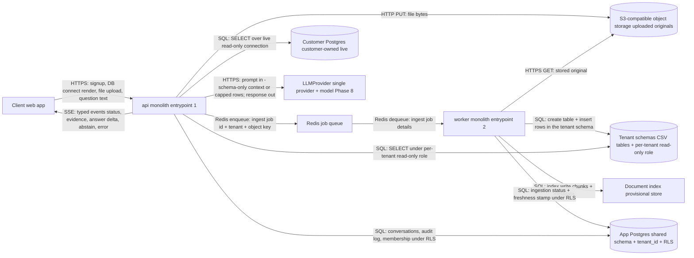

# HLD - Phase 2

Status: draft, 2026-10-31. Source of truth: the Phase 2 decision table + ADR-0004..0010 (docs/decision-log.md). Note: the component diagram was authored by opencode from those sources (no diagram arrived with the handoff; mentor approved authoring). Every component and arrow below is therefore a proposal, mapped to its decision in the decision column.

## Components and responsibilities

| # | Component | Responsibility (one line) | Grounding | Provisional |
|---|---|---|---|---|
| 1 | Client (web app) | Lets Admin/Member sign up, connect the DB, upload files, ask questions, and render streamed typed events (decision 5). | Phase 1 journey; Phase 2 decisions 4-5 | no |
| 2 | api (monolith entrypoint 1) | Serves the fixed pipeline (rewrite -> route -> structured / document / both -> synthesize or abstain), streams answers over SSE, and executes the live queries (decision 4). | Phase 2 decisions 1, 4, 5; ADR-0004 | no |
| 3 | worker (monolith entrypoint 2) | Runs background ingestion: PDF/DOCX parse, CSV type inference, index write, and per-tenant table load. | Phase 2 decisions 1, 2; ADR-0002, ADR-0004 | no |
| 4 | App Postgres | Holds app data (tenants, members, conversations, audit log, ingestion state) in one shared schema scoped by tenant_id and row-level security (ADR-0005). | Phase 2 decisions 1, 2 | no |
| 5 | Tenant schemas (same Postgres) | Hold CSV tables, one schema per tenant, each with its own per-tenant read-only role (ADR-0005). | Phase 2 decision 2 | no |
| 6 | Customer Postgres | The persona's own database, queried live through a read-only role; rows are never copied (ADR-0006). | Phase 2 decision 3 | no |
| 7 | S3-compatible object storage | Stores uploaded PDF/DOCX/CSV originals; the index/serveable state lives elsewhere and rows live in customer infra (ADR-0006, ADR-0002). | Phase 2 decision 1 | vendor identity provisional |
| 8 | Redis | Decouples api from the worker: api enqueues ingestion jobs; worker dequeues them (ADR-0004). | Phase 2 decision 1 | duties beyond the queue provisional |
| 9 | LLMProvider | The single path to the chosen provider and model for every pipeline stage that needs the model (ADR-0009). | Phase 2 decision 6 | provider + model chosen in Phase 8 |
| 10 | Document index | retrieval store for document chunks used by the unstructured path (ADR-0001); its storage location is undecided. | ADR-0001 (unstructured path); ADR-0009 model choice is Phase 8 | storage location provisional |

## Diagram

Diagram authored from the decision table; no library APIs, class names, schemas or prompts named (only component names and protocols).

## What runs where

| Component | Where it runs | Notes |
|---|---|---|
| api | Server process 1 of the monolith (ADR-0004) | Serves streaming questions; holds the pipeline (decision 4). |
| worker | Server process 2 of the monolith (ADR-0004) | Ingestion only; queued via Redis. |
| App Postgres | Managed database (accepted in decision 1) | Shared schema + tenant_id + RLS; isolation per ADR-0005. |
| Tenant schemas | Same Postgres instance as the app store | Per-tenant schema + per-tenant read-only role (ADR-0005). |
| Redis | Managed | Queue duty accepted (decision 1); remaining duties provisional. |
| S3-compatible object storage | Object store (accepted in decision 1) | Vendor identity provisional. |
| LLMProvider | External service | One provider + one model; choice owned by the Phase 8 bake-off (decision 6, ADR-0009). |
| Document index | Undecided | Provisional; see Open questions. |
| Customer Postgres | Customer-operated infrastructure | Live connection; never copied (ADR-0006). |

## Open questions

Not specified in the decision table; listed here instead of being invented (owner phases pending the phase plan):

- OQ-1: Document index storage location and its owner phase.
- OQ-2: Redis duties beyond the job queue (cache, fanout?) and the owner phase that decides.
- OQ-3: S3-compatible vendor identity (self-hosted or provider) and its owner phase.
- OQ-4: Whether connection pooling is a dedicated component or a configuration of the two entrypoints, and its owner phase (the RLS risk row in docs/risk-register.md depends on this).
- OQ-5: SSE infrastructure details - reconnect/resume behaviour and proxy timeout handling - and the owner phase.
- OQ-6: How ingestion completion reaches the Client (push, poll or SSE status event) and the owner phase.
