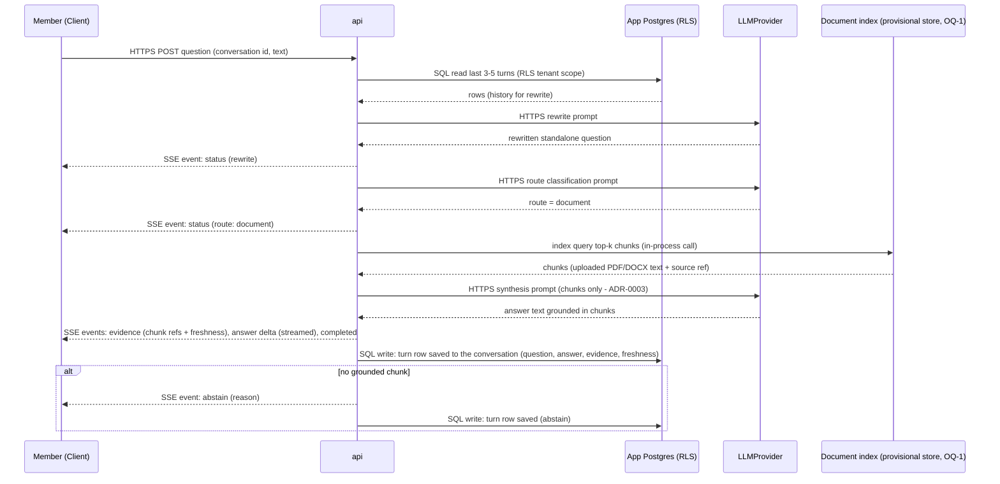
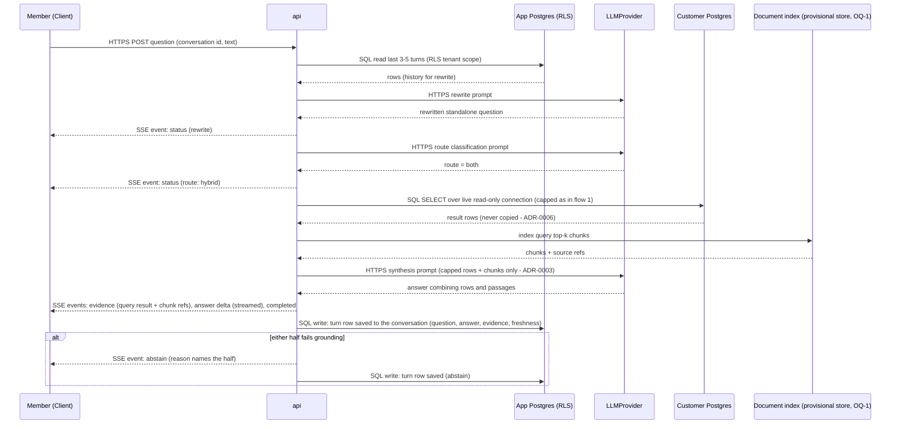

# Data flows - Phase 2

Status: draft, 2026-10-31. Authored by opencode from the Phase 2 decision table, ADR-0001..0010 and the PRD (same provenance note as docs/architecture/HLD.md). All four flows follow the fixed pipeline (ADR-0007). SSE event names are the answer contract's anchor points, kept deliberately generic (no schemas named yet). Reference points: AC-ASK-3 = no invented numbers; AC-ABS = abstain within 30 s (AC-ABS-3); evidence = executed query result or cited chunks; freshness stamp per ADR-0002.

## Flow 1: Structured question

```mermaid
sequenceDiagram
    participant M as Member (Client)
    participant A as api
    participant P as App Postgres (RLS)
    participant L as LLMProvider
    participant C as Customer Postgres
    M->>A: HTTPS POST question (conversation id, text)
    A->>P: SQL read last 3-5 turns (RLS tenant scope)
    P-->>A: rows (history for rewrite)
    A->>L: HTTPS rewrite prompt (schema-only context)
    L-->>A: rewritten standalone question
    A-->>M: SSE event: status (rewrite)
    A->>L: HTTPS route classification prompt (labelled)
    L-->>A: route = structured
    A-->>M: SSE event: status (route: structured)
    A->>L: HTTPS SQL generation prompt (schema only, no samples - ADR-0003)
    L-->>A: SQL string
    A->>C: SQL SELECT over live read-only connection (30 s timeout, 10,000-row cap - decision 7; CSV tables go to the tenant schema on the same instance per PRD AC-CSV-4)
    C-->>A: result rows (never copied to our store - ADR-0006)
    A->>L: HTTPS synthesis prompt (only result rows, capped - decision 6)
    L-->>A: answer text
    A-->>M: SSE events: evidence (query + result shape), answer delta (streamed), completed
    A->>P: SQL write: turn row saved to the conversation (question, answer, evidence, freshness)
    alt cannot ground within budget
        A-->>M: SSE event: abstain (reason; AC-ABS-1)
        A->>P: SQL write: turn row saved (abstain + reason)
    end
```

Checkpoints checked: SSE events emitted at rewrite, route, evidence, answer deltas, completed/abstain (AC-ABS-3 30 s never exceeded); results saved to the conversation at the SQL write (turn row) after the stream completes.

## Flow 2: Document question



Checkpoints checked: streamed answer over SSE; grounded citations (PRD AC-ASK-6 / HG3); save-to-conversation at the turn row write.

## Flow 3: Hybrid question



Checkpoints checked: both paths run (ADR-0001's "both + synthesis" consequence); every number still from the executed result (AC-ASK-3 / AC-ASK-5 record); save-to-conversation as in flows 1-2.

## Flow 4: CSV upload ingestion

```mermaid
sequenceDiagram
    participant AD as Admin (Client)
    participant A as api
    participant P as App Postgres (RLS)
    participant O as S3-compatible object storage
    participant R as Redis
    participant W as worker
    participant T as Tenant schema (per-tenant, read-only role)
    AD->>A: HTTPS POST CSV file (multipart)
    A->>P: SQL limit check (10 CSVs, decision 7) + register row status=pending (RLS tenant scope)
    P-->>A: csv id
    A->>O: HTTP PUT original bytes
    A->>R: Redis enqueue: ingest job (id, tenant, object key)
    R->>W: Redis dequeue
    W->>O: HTTPS GET original
    note over W: type-inference step (ADR-0002); on failure -> status=failed, no partial table
    W->>T: SQL: create table + insert rows in the per-tenant schema (owned by the ingestion connection, NOT the per-tenant read-only role)
    W->>P: SQL write: status=loaded + freshness stamp (ADR-0002)
    A-->>AD: HTTPS status response (delivery mechanism provisional - HLD OQ-6)
    alt ingestion fails (bad CSV, crash, limit)
        W->>P: SQL write: status=failed + reason
        A-->>AD: HTTPS error state (partial table never served - AC-CSV-2)
    end
```

Checkpoints checked: tenant-owned table via ADR-0002; RLS scope on all app-store writes; no cross-tenant leak (HG1) because job carries tenant id; the per-tenant read-only role is used only by the querying api (per PRD AC-DB-2/HG2 for the customer DB, per ADR-0005's per-tenant read-only role for CSV tables), not by the ingestion writer.
